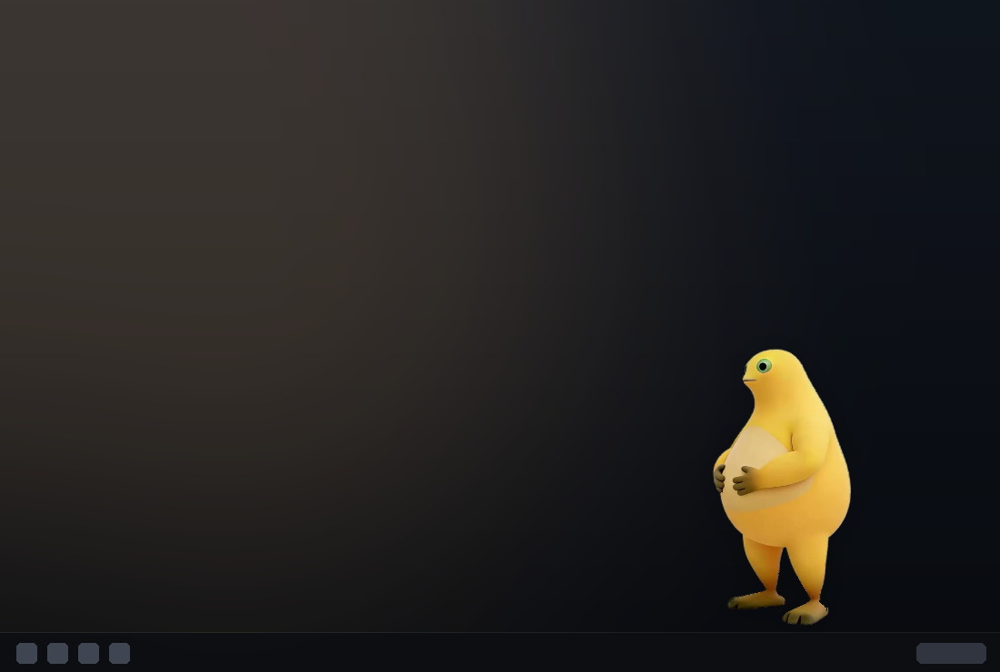
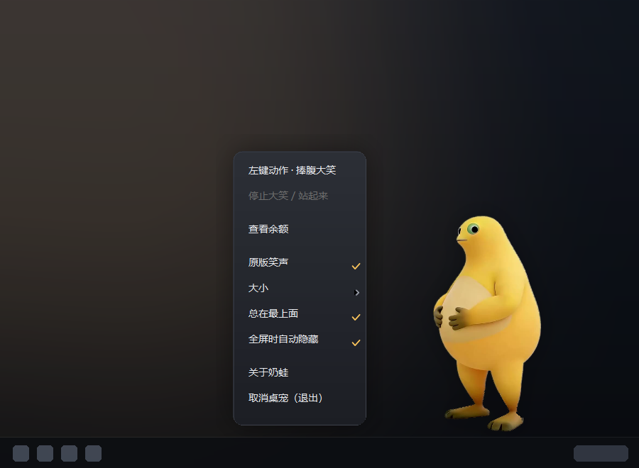
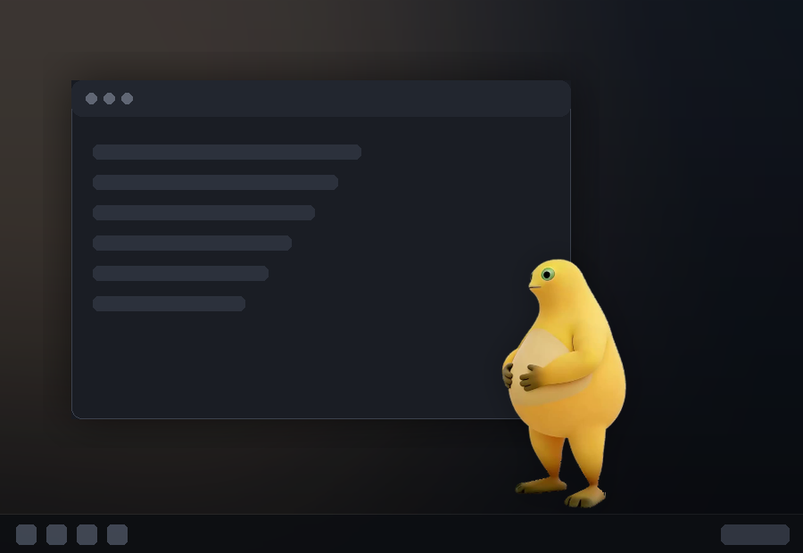
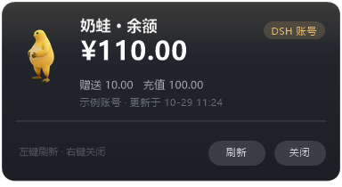

# 奶蛙桌宠

把 [Naiwa](https://github.com/yugh6/Naiwa)（奶蛙）做成一只真正待在 Windows 桌面上的桌宠：**左键一点就笑**（原版笑声 + 捧腹大笑动画），**右键查看 DeepSeek 余额、戳肚子、调大小、取消桌宠**。同时它也是一个 DeepSeek Harness（DSH）插件——装进 profile 就跟着 DSH 一起上下班。

形象与音效全部取自原项目，分层窗口、DPI、全屏检测等底层逻辑沿用原作者 **Naiwa.cs**，在此基础上加了余额卡片、自绘菜单与插件封装。



## 功能

| 交互 | 效果 |
| --- | --- |
| 左键单击 | 菜单里选的动作：捧腹大笑（原版笑声，约 14 秒，笑完躺地；再单击站起来）或戳肚子 |
| 左键连点 | 戳肚子可以连点；捧腹大笑播放中不响应点击、不会重播 |
| 左键拖动 | 拖到任意位置，松手微弹，位置/大小/置顶都会记住 |
| 右键 | 深色圆角菜单，点菜单以外的地方或再点一次右键收起 |
| 托盘图标 | 双击叫回屏幕右下角，右键同一菜单 |

右键菜单：**左键动作 · 捧腹大笑／戳肚子**（一行直接切换，行文字就是当前状态）· 停止大笑/站起来 · **查看余额** · 原版笑声开关 · 大小（小/标准/大）· 总在最上面 · 全屏时自动隐藏 · 关于奶蛙 · **取消桌宠（退出）**



分层透明窗口（不是白底窗体），可以浮在其他窗口上方，也可以关掉置顶藏在后面：



### 余额卡片

右键 →「查看余额」，卡片从奶蛙头顶弹出。

**零配置**：不用填 Key。只要这台机器上的 DSH 登录过 DeepSeek 账号，奶蛙会读取 Harness 保存的登录凭据（`~/.dsh/.credentials.yaml` 中 `deepseek-account-platform/default` 那条 grant），带 `x-dsh-auth-token` 调 `GET https://platform.deepseek.com/api/v0/users/get_user_summary`，显示账号名、余额、赠送/充值明细与更新时间——与 Harness 账户页同源。未登录时卡片显示「未登录」。



<sub>卡片示意图：实际显示你当前账号的名字和金额。</sub>

也想用 API Key 或自建接口？首次打开「查看余额」会在 exe 旁生成 `config.json`，留空 `apiKey`、`provider` 保持 `auto` 就跟随 Harness 账号；填了 `apiKey` 则优先用 Key 直连 `https://api.deepseek.com`。自定义接口走 `provider: "custom"` 加 `customUrl` / `customHeader` / `customJsonPath`。请求全程本机发出，凭据只发给 `platform.deepseek.com`（或你自己配的地址）。

## 安装

### 从 DSH 插件市场安装（推荐）

在 DSH 设置 → 插件 → 发现 → 管理索引源，加入：

```
https://raw.githubusercontent.com/991903428/dsh-naiwa-pet/main/market/index.json
```

刷新后即可看到「奶蛙桌宠」并一键安装。

### 命令行安装

```bash
dsh plugin --profile desktop add "git+https://github.com/991903428/dsh-naiwa-pet.git#9322295f0e456abf5221f3314634c82e91da19fc&path:/plugin/dsh-naiwa-pet"
```

装完重启 DSH 即可。配置在 `plugin/dsh-naiwa-pet/cordis.patch.yml`：`autoStart`（默认 true，随 DSH 启动）、`exePath`（默认用包内 `pet/奶蛙桌宠.exe`）、`stopOnExit`（默认 true，DSH 退出时把桌宠一起收走）。

桌宠跟着 DSH 的命走：插件每两秒写一次心跳文件（`%LOCALAPPDATA%\NaiwaPetPlus\dsh-heartbeat`），DSH 一关（哪怕被强杀）心跳就停，桌宠最多十秒自己离开桌面；正常退出几秒内收走。

装好以后 **设置左侧栏 → 「奶蛙」** 会多一页：显示它在不在桌面上、在哪个位置、正在做什么，一个按钮打开或关闭它。这一页需要重启一次 DSH 才会出现（客户端插件清单在启动时缓存），之后改动都是热更新。

### 插件给模型的工具

| 工具 | 作用 |
| --- | --- |
| `naiwa_pet` | `start` / `stop` / `status` / `laugh` / `poke` / `stand` |
| `naiwa_balance` | 查当前账号余额（账户名、总额、赠送、充值），`showCard` 可在桌面弹卡片 |

### 只想单独运行

下载 `plugin/dsh-naiwa-pet/pet/` 整个目录（`奶蛙桌宠.exe` + `素材.nwp` + `原版笑声.wav`），双击 `奶蛙桌宠.exe` 即可；此时没有心跳，它会一直待着，直到右键「取消桌宠」。

## 从源码构建

需要 .NET Framework 4.x 自带的 `csc.exe`（Windows 10/11 默认就有），无需安装 SDK：

```bat
build.cmd
```

产物在 `bin\`：`奶蛙桌宠.exe`，并自动从 `plugin\dsh-naiwa-pet\pet\` 取 `素材.nwp`、`原版笑声.wav`、`使用说明.txt`。

源码：

- `src/NaiwaPet.cs` —— 桌宠主体（分层透明窗口、动画状态机、手势、托盘、右键菜单、余额卡片集成）
- `src/BalanceCard.cs` —— 余额配置解析、HTTP 请求、透明卡片绘制
- `src/DshAccount.cs` —— 读取 Harness 登录凭据，实现零配置余额
- `src/MenuTheme.cs` —— 右键菜单的深色自绘主题（圆角渐变、悬停高亮、对勾与箭头、圆角裁剪）

### 自检

```bat
bin\奶蛙桌宠.exe --self-test out
```

跑 140 项断言（点击即笑、戳肚子连点、大笑不重播、左键动作切换与持久化、拖动、全屏隐藏、菜单项、余额解析、卡片像素命中……），并导出渲染帧与卡片预览，全程不联网、不改你的设置。

其他参数：`--probe -` 输出窗口状态、`--fetch-balance -` 打印余额、`--do laugh|poke|stand|balance` 给运行中的实例发动作、`--render-card <dir>` 导出卡片预览、`--quit` 关闭已运行实例。

## 实现要点

- **分层透明窗口**：`CreateDIBSection` 32bpp + `UpdateLayeredWindow`（预乘 alpha），`WS_EX_LAYERED | WS_EX_TOOLWINDOW | WS_EX_NOACTIVATE`，不进任务栏、不抢焦点；`WM_NCHITTEST` 做 alpha 命中测试，透空处点击直接穿透。
- **动画**：422 帧捧腹大笑 30 fps，LRU 缓存 12 帧；转头看鼠标、随机眨眼、拖动倾斜、戳肚子压缩。
- **全屏检测**：优先 DWM 扩展边框，判断别的窗口是否糊满整块屏幕，是就自动隐藏（可关）。
- **余额卡片**：同样是分层透明窗口，GDI+ 绘制渐变圆角与阴影，DPI 感知；`HttpWebRequest` + `JavaScriptSerializer`，不引入 `System.Net.Http`，保持绿色单文件。

## 署名与许可

- 形象、音效、原版程序：**Naiwa**，作者 **yugh6**（抖音：握石竹），<https://github.com/yugh6/Naiwa>
- 本仓库代码：MIT（见 `LICENSE`）
- 形象与音效素材：沿用上游 **PolyForm Noncommercial 1.0.0**（见 `LICENSE-ASSETS-PolyForm-Noncommercial-1.0.0.txt` 与 `plugin/dsh-naiwa-pet/LICENCE`），**仅限个人非商业使用**
- 分享请注明原作者与原项目地址，请勿冒充原创，也不要用于原作者明确禁止的用途
